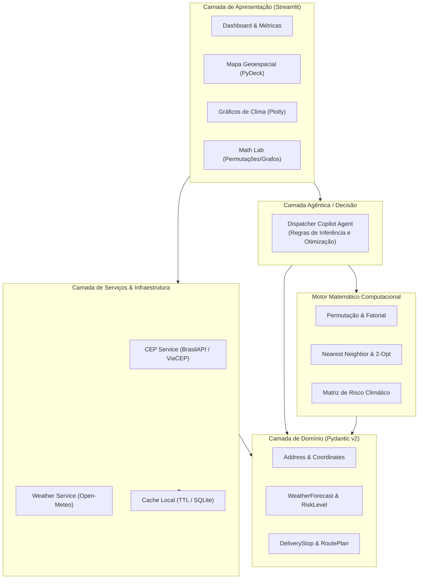
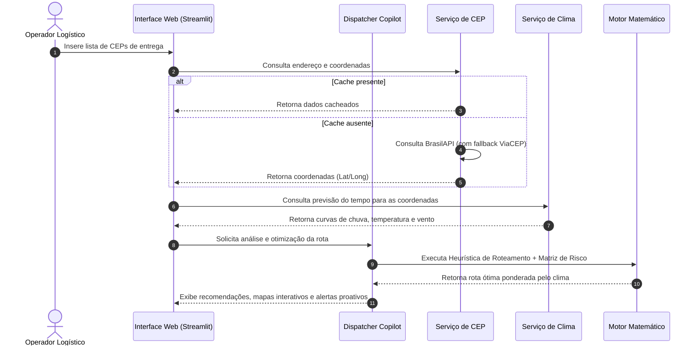

# 📐 Arquitetura do ApoioCEP

Este documento descreve as decisões arquiteturais, padrões de projeto e o fluxo de dados do sistema **ApoioCEP** (*Painel de apoio a entregas com CEP e clima*).

---

## 1. Visão Geral da Arquitetura

O sistema adota os princípios de **Clean Architecture** (Arquitetura Limpa) e **Domain-Driven Design (DDD)** simplificado para Python, garantindo desacoplamento entre regras de negócio, serviços de infraestrutura e a camada de interface gráfica.

---

## 2. Descrição das Camadas e Regras de Cada Pasta

| Diretório | Responsabilidade | Regra de Governança |
| :--- | :--- | :--- |
| `config/` | Configurações globais e leitura de variáveis de ambiente. | Utilizar `pydantic-settings`. Proibido `hardcode` de URLs ou timeouts no código de serviço. |
| `src/domain/` | Modelos de dados puros e invariantes de negócio. | Devem herdar de `pydantic.BaseModel`. Proibido conter lógica de IO ou chamadas de rede. |
| `src/services/` | Comunicação com APIs externas e persistência de cache. | Devem implementar retries (`tenacity`), tratamento de falhas e fallback entre provedores. |
| `src/mathematics/` | Implementação formal dos tópicos de Matemática Computacional. | Funções puras e sem efeitos colaterais. Devem possuir anotações de complexidade $O(f(n))$. |
| `src/agent/` | Inteligência agêntica e regras de despacho inteligente. | Cruza as restrições de entregas com os vetores climáticos para emitir alertas e reordenar rotas. |
| `src/ui/` | Componentes visuais e visualizações analíticas em Streamlit. | Proibido chamar APIs externas diretamente; deve sempre consumir `services` e `agent`. |
| `tests/` | Suíte de testes unitários e de integração com `pytest`. | Cobertura mínima nas camadas `domain`, `mathematics` e `services`. |
| `data/` | Massas de dados fictícios para demonstração e mockups. | Arquivos JSON estáticos e dados em conformidade com a LGPD. |

---

## 3. Fluxo de Dados e Resiliência

---

## 4. Governança e Performance

1. **Validação Estrita:** Nenhum dado não validado transita entre camadas.
2. **Resiliência:** Tolerância a falhas transitórias com backoff exponencial.
3. **Cache Inteligente:** Reduz em até 95% o número de requisições externas para consultas recorrentes na mesma região.
