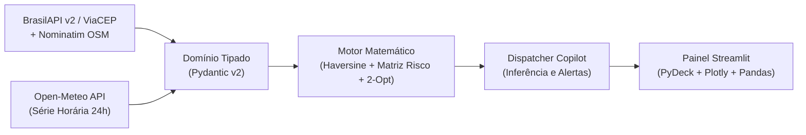

# 🖼️ Guia Completo de Conteúdo e Diagramação do Pôster — Amostra A3 (Expounicuritiba)

> **Evento:** Apresentação Oficial da Amostra A3 — UniCuritiba (Expounicuritiba)  
> **Data de Exposição:** 01/12/2026  
> **Unidade Curricular:** Matemática Computacional Aplicada  
> **Docentes Orientadores:** Prof. Aron e Prof. Cristiano  
> **Repositório de Código-Fonte:** [github.com/Budaxz/ApoioCEP](https://github.com/Budaxz/ApoioCEP.git)

---

## 📌 1. Cabeçalho Institucional (Topo do Pôster)

* **Título Principal:** **ApoioCEP: Painel Inteligente de Roteirização Logística Urbana Integrado a Geocodificação Postal e Risco Meteorológico Hiperlocal**
* **Subtítulo:** Otimização Combinatória (*Nearest Neighbor + 2-Opt*), Espaço Métrico de Haversine e Copiloto Agêntico para Despacho de Entregas sob Incerteza Climática
* **Curso / Instituição:** Ciência da Computação / Engenharia de Software — UniCuritiba
* **Disciplina:** Matemática Computacional Aplicada (Projeto Prático A3 — 2026/2)
* **Professores Orientadores:** Prof. Aron e Prof. Cristiano

---

## 🎯 2. Problema Real e Público-Alvo (Coluna Esquerda — Superior)

### 2.1 Contextualização do Problema Real
O setor de logística urbana de última milha (*last-mile delivery*) em capitais com alta instabilidade atmosférica — como **Curitiba/PR** — sofre perdas operacionais recorrentes devido a eventos meteorológicos severos (pancadas de chuva intensas, alagamentos súbitos e rajadas de vento). Ferramentas tradicionais de roteirização consideram exclusivamente a distância estática entre pontos, ignorando:
1. A **explosão combinatória ($n!$)** na ordenação manual ou ingênua de dezenas de paradas;
2. A **variação espaço-temporal do clima** por bairro e janela horária, que frequentemente direciona entregadores diretamente para áreas sob tempestade crítica;
3. O **risco de avaria em cargas sensíveis** (medicamentos, livros, eletrônicos) e o aumento de sinistros viários.

### 2.2 Público-Alvo Beneficiado
* **Pequenos e médios centros de distribuição urbana** e operadores de *e-commerce* local;
* **Despachantes logísticos** e coordenadores de frotas leves;
* **Entregadores autônomos, cooperativas de motofrete** e comércios varejistas (farmácias, livrarias, autopeças).

---

## 💡 3. Solução Desenvolvida: Arquitetura do ApoioCEP (Coluna Esquerda — Inferior)

O **ApoioCEP** é uma plataforma analítica e prescritiva desenvolvida em **Python 3.10+** e **Streamlit**, estruturada sob princípios de **Clean Architecture** e **Domain-Driven Design (DDD)**:

### Diferenciais Técnicos da Solução
1. **Geocodificação Postal Multi-Provedor Resiliente:** Consulta primária na **BrasilAPI v2** com *fallback* automático para **ViaCEP**, geocodificação via **Nominatim (OpenStreetMap)** e coordenadas determinísticas por bairro de Curitiba, apoiada por **Cache SQLite local com TTL** e *retries* exponenciais (`tenacity`).
2. **Previsão Hiperlocal Horária (Open-Meteo):** Extração de séries de 24h para precipitação ($\text{mm/h}$), probabilidade de chuva ($\%$), velocidade do vento ($\text{km/h}$) e temperatura ($^\circ\text{C}$).
3. **Copiloto Agêntico de Despacho (`DispatcherCopilot`):** Motor de inferência que reordena paradas minimizando distância e exposição à chuva, identifica a melhor janela operacional contínua de 3 horas e emite alertas táticos priorizados.

---

## 🧮 4. Conteúdos da Disciplina Aplicados e Localização no Código (Coluna Central)

Todos os módulos matemáticos foram implementados com funções puras, tipagem estática estrita (`mypy`) e cobertura de testes automatizados (`pytest`):

| Eixo Matemático / Computacional | Formulação Matemática Aplicada | Aplicação Prática no Software | Localização Exata no Código |
| :--- | :--- | :--- | :--- |
| **1. Princípios de Contagem e Permutação Simples** | $$P_n = n! = \prod_{k=1}^{n} k$$ | Cálculo da cardinalidade do espaço de busca $\mathcal{S}_n$, estimativa de tempo combinatório e solucionador exato por Força Bruta ($n \le 8$). | `src/mathematics/permutations.py` (`calculate_factorial`, `solve_tsp_brute_force`) |
| **2. Teoria dos Grafos e Heurísticas Polinomiais** | $$v^* = \arg\min_{v \in U} C_{u,v}(\alpha)$$ | Heurística construtiva *Nearest Neighbor* ($O(n^2)$) combinada ao operador de busca local **2-Opt** para eliminação de cruzamentos de arestas. | `src/mathematics/routing.py` (`optimize_route_nearest_neighbor`, `refine_route_2opt`) |
| **3. Geometria Esférica e Espaço Métrico** | $$d = 2R \arcsin\sqrt{\sin^2\left(\frac{\Delta\phi}{2}\right) + \cos\phi_1\cos\phi_2\sin^2\left(\frac{\Delta\lambda}{2}\right)}$$ | Cálculo exato da distância geodésica em quilômetros ($R = 6371\text{ km}$) entre coordenadas de CEPs. | `src/domain/address.py` (`Coordinates.distance_to`) |
| **4. Álgebra Linear e Matriz de Risco Ponderada** | $$R_{i,t} = 0{,}50 f_{\text{rain}} + 0{,}30 f_{\text{wind}} + 0{,}20 f_{\text{prio}}$$ $$C_{a,b} = d_{a,b} \cdot (1 + \alpha \cdot R_b)$$ | Normalização multidimensional em $[0, 1]$ e penalização dinâmica das arestas do grafo pelo coeficiente de aversão ao risco $\alpha \in [0, 2]$. | `src/mathematics/risk_matrix.py` (`compute_stop_risk_score`, `calculate_weighted_edge_cost`) |
| **5. Estatística Descritiva e Séries Temporais (Pandas)** | $$MM_{3\text{h}}(t) = \frac{1}{3}\sum_{k=0}^{2} p_{t-k}$$ | Construção de `DataFrames`, distância acumulada, média móvel de precipitação de 3h (`rolling(3).mean()`) e exportação CSV UTF-8 BOM. | `src/services/route_analytics.py` (`stops_to_dataframe`, `weather_to_dataframe`) |
| **6. Visualização Científica e Geoespacial** | Escala logarítmica $\log_{10}(n!)$ e projeção cartográfica WebGL | Gráficos interativos de eixo duplo (**Plotly**) e mapa vetorial de trajetória e risco (**PyDeck**). | `src/ui/components/charts.py` e `src/ui/components/map_view.py` |

---

## 📊 5. Resultados Obtidos e Validação Experimental (Coluna Direita — Superior)

### 5.1 Comparativo Assintótico: Força Bruta $O(n!)$ vs Heurística Polinomial $O(n^2)$
Experimentos conduzidos no módulo **Laboratório de Matemática Aplicada** demonstram por que a abordagem heurística é indispensável em produção:

| Nº de Paradas ($n$) | Espaço Fatorial ($P_n = n!$) | Operações Heurísticas ($n^2$) | Tempo Força Bruta Estimado | Tempo *Nearest Neighbor + 2-Opt* |
| :---: | :---: | :---: | :---: | :---: |
| **5 paradas** | $120$ | $25$ | $0{,}08\text{ ms}$ | $< 0{,}30\text{ ms}$ |
| **8 paradas** | $40.320$ | $64$ | $\approx 26{,}88\text{ ms}$ | $< 0{,}80\text{ ms}$ |
| **10 paradas** | $3.628.800$ | $100$ | $\approx 2{,}42\text{ s}$ | $< 1{,}20\text{ ms}$ |
| **12 paradas** | $479.001.600$ | $144$ | $\approx 5{,}32\text{ min}$ | $< 1{,}80\text{ ms}$ |

### 5.2 Estudo de Caso Realista em Curitiba (Roteiro de 5 Bairros)
Na simulação padrão partindo da **Praça Tiradentes (Centro)** com entregas no **Centro**, **Batel**, **Jardim Botânico** e **Portão**:
* **Qualidade da Solução (*Gap* de Otimalidade):** Para $n \le 8$, a heurística **Nearest Neighbor + 2-Opt** atinge **gap de $0{,}0\%$ a $< 2{,}0\%$** em relação à solução ótima global da Força Bruta, reduzindo a quilometragem total frente à ordem empírica de cadastro.
* **Mitigação de Risco Climático:** Com $\alpha \ge 0{,}5$, o algoritmo antecipa entregas de alta prioridade e reordena o trajeto, identificando proativamente paradas sob alerta **CRÍTICO** (chuva $\ge 15\text{ mm/h}$ ou vento $\ge 50\text{ km/h}$) e recomendando a melhor janela seca de 3h (`08:00 - 11:00`).
* **Qualidade de Software:** Suíte automatizada com **100% de aprovação no `pytest`**, zero alertas no linter **`ruff`** e verificação estática **`mypy`** sem erros.

---

## 🏁 6. Conclusões e Trabalhos Futuros (Coluna Direita — Inferior)

### 6.1 Conclusões Principais
1. **Viabilidade Computacional:** A substituição da busca exaustiva $O(n!)$ pela heurística construtiva com refinamento local *2-Opt* ($O(n^2)$) viabiliza o cálculo instantâneo de rotas em tempo real na interface web sem perda significativa de otimalidade.
2. **Valor Prático da Modelagem Matemática:** A ponderação das arestas geodésicas de Haversine por uma matriz probabilística de risco climático ($C_{a,b} = d_{a,b} \cdot (1 + \alpha R_b)$) transforma dados meteorológicos brutos em decisões logísticas acionáveis, protegendo mercadorias e entregadores.
3. **Resiliência de Engenharia:** A arquitetura em camadas com cache SQLite e *fallback* automático entre provedores públicos garante alta disponibilidade mesmo sob instabilidade nas APIs externas.

### 6.2 Trabalhos Futuros
* Integração com malha viária real (*OpenStreetMap Routing Machine — OSRM*) para distâncias por arruamento e sentido de vias;
* Extensão para múltiplos veículos (*Capacitated Vehicle Routing Problem — CVRP*) considerando o limite de peso (`package_weight_kg`) por modal.

---

## 🎨 7. Recomendações Visuais para Diagramação do Pôster (Formato A3 / Banner)

1. **Paleta de Cores Sugerida (Alinhada ao Tema da UI):**
   * **Cabeçalho e Títulos:** Azul Marinho Profundo (`#0F172A` e `#1E3A8A`);
   * **Destaques e Equações:** Azul Royal (`#2563EB`) com fundo suave (`#EFF6FF`);
   * **Semáforo de Risco Climático:** Verde (`#10B981` — Baixo), Âmbar (`#F59E0B` — Moderado), Laranja (`#F97316` — Alto) e Vermelho (`#EF4444` — Crítico).
2. **Elementos Gráficos Obrigatórios para Captura de Tela (*Screenshots*):**
   * **Figura 1 (Centro):** Mapa interativo **PyDeck** mostrando os arcos da rota otimizada em Curitiba e os pontos coloridos por risco climático;
   * **Figura 2 (Centro-Direita):** Gráfico **Plotly** em escala logarítmica comparando a curva vermelha $O(n!)$ com a curva verde $O(n^2)$;
   * **Figura 3 (Direita):** Gráfico de série horária com barras de precipitação ($\text{mm/h}$), linha tracejada da média móvel de 3h e curva de temperatura;
   * **QR Code no Rodapé:** Apontando diretamente para o repositório oficial `https://github.com/Budaxz/ApoioCEP.git`.
